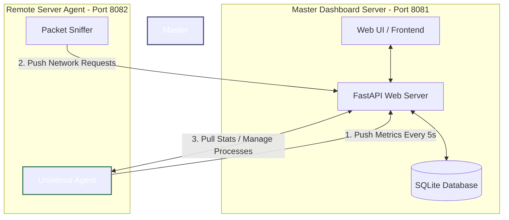

# 🖥️ Unified Ops Dashboard: Master-Agent Architecture

The **Unified Ops Dashboard** uses a hybrid Master-Agent model that supports both pull-based and push-based mechanics to monitor multiple servers in real time. 

---

## 📐 Architecture Diagram



---

## ⚙️ Core Mechanics

### 1. Push-Based Metrics (Telemetry)
* **Periodic Push:** The Remote Agent runs a background thread (`MetricPusher`) that wakes up every 5 seconds (configurable) to collect CPU, memory, disk, network, uptime, and active connection metrics.
* **Master Endpoint:** The Agent POSTs this telemetry data to the Master Server's `/api/agent/submit` endpoint.
* **Authentication:** Every push request contains an `Authorization: Bearer <API_KEY>` header.

### 2. Pull-Based & Action-Oriented API (Control Plane)
* **On-Demand Pull:** When a user navigates to specific tabs on the dashboard (e.g., *Processes*, *Connections*, *Logs*), the Master Server sends HTTP requests to the respective agent’s API.
* **Control Actions:** Actions like killing a process are initiated from the Master Dashboard UI, routed through the Master API, and sent to the agent's `/api/processes/kill` endpoint.

### 3. Asynchronous Packet Sniffing (Requests Tab)
* **Buffer & Flush:** If `scapy` is installed on the agent, it runs a background packet sniffer on the active network interface. Sniffed HTTP/HTTPS metadata is accumulated in a local buffer and flushed every 3 seconds to the Master's `/api/agent/submit_requests` endpoint to avoid overloading the network.

---

## 🚀 How to Add a New Server Agent

Follow these steps to deploy and register a new agent on a remote server:

### Step 1: Prepare the Remote Agent
On the server you wish to monitor:
1. Clone the dashboard codebase or copy the `agent.py` and `requirements.txt` files to the server.
2. Install the python dependencies:
   ```bash
   pip install -r requirements.txt
   ```
3. *(Optional)* If you want to enable packet sniffing for the **Requests** tab:
   * **Windows:** Install [Npcap](https://npcap.com/) (select "Install Npcap in WinPcap API-compatible Mode").
   * **Linux:** Install `libpcap` using your package manager (e.g., `sudo apt install libpcap-dev`).

### Step 2: Configure the Agent (`agent_config.json`)
Create or edit `agent_config.json` in the same directory as `agent.py`:

```json
{
  "agent_port": 8082,
  "master_url": "http://<MASTER_SERVER_IP>:8081",
  "master_api_key": "YOUR_SECRET_KEY_HERE",
  "hostname": "production-web-01",
  "metric_push_interval": 5,
  "interface": null,
  "log_files_to_analyze": {
    "web_server": "/var/log/nginx/access.log"
  }
}
```

> [!IMPORTANT]
> Make sure the `"master_api_key"` matches the `"master_api_key"` defined in the Master server's `config.json`.

### Step 3: Run the Agent
* **Windows (Administrator Terminal):**
  ```powershell
  python agent.py
  ```
* **Linux (Root / Sudo Required for Sniffing & Core Ops):**
  ```bash
  sudo python3 agent.py
  ```

### Step 4: Register the Agent on the Master Server
On your Master Dashboard server, open `C:\ProgramData\ServerMonitor\config.json` and add the new agent to the `"agents"` list:

```json
{
  "agents": [
    {
      "hostname": "production-web-01",
      "url": "http://<AGENT_SERVER_IP>:8082",
      "api_key": "YOUR_SECRET_KEY_HERE"
    }
  ]
}
```

Restart the Master Dashboard or wait for it to reload the config dynamically. The new server will now appear in the **Server Status** and **Comparison** tabs on the web UI!
